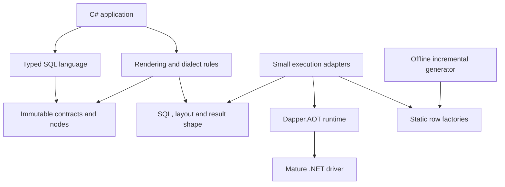

# Architecture and decisions

Status: **proposed, version 0.2.0**. The reopened research selects mature runtime
reuse and supersedes the first delivery's own Binder/Projector default. This is a
reviewable implementation specification, not an installed product or permission
to implement, release, migrate, retire or merge. The Plan graph pins this Design
revision; every product task remains `planned_candidate`.

## Selected architecture

Use a source-translated jOOQ SQL language in modern C#, the unmodified Dapper.AOT
1.1.0 runtime for command/reader execution, generated derived RowFactory<T>
implementations, a small typed-layout CommandFactory adapter and mature .NET
drivers. The original Dapper.AOT interceptor plus controlled explicit
DynamicParameters route also works; it remains a compatibility/reference route.
It is no longer used as an untested reason to build a replacement executor.

[The mature execution investigation](mature-execution.md) records actual source
paths, successful original-library and runtime-factory native executions, the
four-database matrix and measured allocation/runtime tradeoffs. [Generation
integration](generation-integration.md) proves a normal incremental generator can
emit the required factories and preserve a generic Fluent facade. [Java execution
options](java-execution-options.md) records the successful C# Native AOT to Graal
native JDBC path and source-level jOOQ mapping inheritance. Those results support
research stop condition A: this combination merits formal implementation. They do
not establish complete product correctness or production performance parity.

## Product and dependency boundary

Korda.Orm expresses SQL, including runtime optional predicates and dynamic list
cardinality, without driver I/O or runtime code generation. SQL type/field/parameter
identities remain known. Rendering exports SQL, ordered typed occurrences and a
logical/physical result shape atomically. The executor consumes that boundary; it
never visits an AST or reparses SQL to discover parameter names. Query extension
terminals are a thin facade which calls the renderer before entering execution.

The exact assembly/file map is fixed in [implementation-spec](implementation-spec.md).
Contracts owns immutable nodes and handle data. Language implements composition and
validation. Dialect projects consume Contracts/Types/Language and pure nested lowering.
Profile.Create attaches its static rules implementation through a Contracts interface;
Rendering consumes that interface without referencing a concrete dialect. Nested lowering consumes pure shared descriptors,
not a RenderContext or executor. Execution references the pure products for its
facade and metadata contracts but introduces Dapper/ADO.NET only on its own side.
The standalone execution API also accepts explicitly declared SQL/templates and
static factories; it does not require a Fluent query or Source Generator.

| Component | Fixed responsibility | Mature implementation retained |
| --- | --- | --- |
| Contracts/types | SQL identity/facets/nullability, logical slots, immutable values, scopes, result shape | jOOQ DataType/Param/Field/Record semantic distinctions |
| Language | Typed operators, query/DML/CTE/set/window composition, contextual validation | Pinned concrete jOOQ node algorithms and documented C# changes |
| Rendering/dialects | Checked lowerings, SQL plus exact occurrence/result emission | jOOQ accept/traversal/quoting/version-specific rules where OSS bodies exist |
| Command adapter | Visit typed cells, create provider parameters once, defensive early cleanup | Dapper CommandFactory/UnifiedCommand protocol and mature command runner |
| Mapping generator | Compile-time constructor/init/member selection, strict shape wrapper, closed read delegates | Dapper Tokenize/Read split plus jOOQ Records.mapping/Converter/presence semantics |
| Execution | Admission/ownership facade and direct calls to runtime sync/async/buffer/stream endpoints | Dapper reader loops, token storage, command/reader cleanup |
| Providers | Closed parameter/read codecs and explicit server/metadata validation | Npgsql, Microsoft.Data.Sqlite, MySqlConnector transport/pooling/cancellation |
| Schema/generation | Deterministic offline metadata, normal Roslyn host integration | jOOQ metadata semantics adapted to the selected provider catalogs |

No Korda connection pool, scheduler, worker thread, automatic retry, protocol,
reader loop, dynamic IL mapper or Java runtime is part of the selected product.
SQLite's driver-owned native library and Native AOT's ordinary linker are distinct
from introducing another query execution engine.

## Architecture decisions

### ORM-ADR-01: perform a traceable semantic source translation

Retain jOOQ's concrete SQL algorithms and tests that are actually available in its
OSS tree. Record source commit/path/symbol, changed mechanism, reason and local
semantic case per operation. Java mutable builder state becomes immutable C#
records and frozen arrays; JDBC/attached execution leaves the language model;
reflection-based constructor discovery moves to compilation. QOM's experimental
surface is evidence for decomposition, not a new public dependency.

The previous open choices are now fixed: record node layout, explicit NodeKind
visitor, typed cells, occurrence policy, project ownership and public operations.
No task chooses an alternative AST, binder architecture, template identity or
visitor during implementation. [Language research](language-model.md) remains
valid; the exact surface and algorithms are in implementation-spec and the packets.

### ORM-ADR-02: export a value-free template and explicit invocation

RenderedTemplate<T>/RenderedMutationTemplate contain immutable SQL, profile,
physical occurrences and result metadata. BoundCommand<T>/BoundMutation add one
frozen ParameterValues snapshot and one atomic consumed flag. Every textual
parameter occurrence gets a physical parameter; labels never identify slots.
Expanded-list arity is structural input, and Bind rejects a changed length.
Ordinary Eq(value) captures a typed slot; only explicit Literal enters SQL text.

Templates can be held and reused explicitly. There is no initial global shape
cache, pooled invocation buffer, speculative prepare or command recycling.
TemplateId is a canonical SHA-256 shape fingerprint, not CLR GetHashCode and not
permission to bind another query instance's slot identities. Mutable input arrays
are snapshotted; no borrow-across-await convention is hidden in the ordinary API.

### ORM-ADR-03: reuse Dapper.AOT runtime and generate its factory subclasses

This replaces version 0.1's own Binder/Projector default. The original explicit
parameter-bag path was successfully executed as Native AOT; its object-template
branch was separately shown to fail at runtime despite a warning-free publish.
The runtime APIs support explicit factories and therefore bypass the limitation
that an open generic Dapper wrapper is not intercepted. A normal generator emits
factory subclasses and static registration directly; developers retain natural
Fluent terminals and known DTO/record/init mapping.

Pin the upstream version and isolate its dependency in Execution. Upgrades rerun
factory API, lifecycle, generator, diagnostic and exact-package tests. No runtime
fork is required for the selected baseline. One small GetCommand override closes
the proven early-initialization cleanup gap; it retains the original exception if
Dispose also fails. Provider encoders replace repeated bag/name discovery because
the renderer already knows each type and occurrence. Measured allocation savings
support this adapter; no small timing result justifies replacing the mature loop.

### ORM-ADR-04: separate capability, transport and result correctness

Profiles state family, tested version range and relevant settings. An operation
is native, a checked equivalent lowering, unsupported or planned/unverified.
Only the first two execute. Never silently drop RETURNING, locks, ordering,
materialization, conflict intent or unsupported types. Native single-command
RETURNING is supported per mutation kind; generated-key/follow-up-SELECT emulation
requires a separate future execution-plan contract.

All four database profiles are mandatory for the baseline acceptance matrix;
provider-specific operations retain independent supported/unsupported cells.
SQLite scalar subqueries require an at-most-one proof to preserve the common
cardinality contract. SQL integer SUM uses an explicit checked decimal carrier;
SQLite exact decimal aggregation remains unsupported. These are defined semantic
boundaries, not implementation choices to resolve later.

### ORM-ADR-05: strict static mapping with an honest empty-result boundary

CompiledMapping<T>.Bind validates logical result members and prepares immutable
closed reader delegates. Tokenize validates actual physical columns before the
first row is returned. A declared reordered projection can map to the same DTO;
actual unexpected ordering cannot silently pass merely because aliases form the
same set. Optional nested rows use an explicit discriminator; absent payload is
not read, while a present required child value still rejects DBNull.

Dapper's runtime calls Tokenize only after the first successful Read. Empty results
therefore return empty without a schema mismatch promise. A separate direct-reader
oracle tests empty schemas; no hidden query or replacement loop changes this.
[Generation integration](generation-integration.md) fixes DTO attributes, constructor
selection, closed scalar/row registration, analyzer hosting and failure diagnostics.

### ORM-ADR-06: use ordinary C# development and preserve isolation

The product baseline is .NET 11.0.0 / SDK 11.0.100 / C#15. The generator is portable
netstandard2.0 with the fixed Roslyn/private dependency closure. Experimental
PreCompilation APIs and a two-stage build are tested alternatives, not default
production requirements. Schema acquisition is an explicit tool action; normal
compilation never opens a database. AOT publication executes native consumers and
forbids silent reflective/dynamic-IL fallbacks.

Implement independently under src/Orm and tests/Orm. Accept the new product, then
consider a separately authorized migration and retirement. Existing product code,
C++ execution, historical tasks and released package identities remain outside this
research change. No compatibility wrapper through the old executor is required.

## Seven fixed public packages

| Package | Contents and dependency contract |
| --- | --- |
| Korda.Orm | Pure contracts/types/language/rendering/dialects/neutral schema and pure advanced/nested components; no Dapper or driver |
| Korda.Orm.Execution | One shared Execution assembly, Dapper.AOT runtime dependency and pure product dependency; usable with explicit SQL/templates/static factories |
| Korda.Orm.PostgreSql | PostgreSQL adapter/metadata plus Execution and Npgsql only |
| Korda.Orm.Sqlite | SQLite adapter/metadata plus Execution and Microsoft.Data.Sqlite/native closure only |
| Korda.Orm.MySql | MySqlConnector adapter with separately validated MySQL/MariaDB profiles |
| Korda.Orm.Generators | Analyzer/build assets and private host dependencies; no runtime DLL injection |
| Korda.Orm.Schema | Explicit framework-dependent schema CLI with the declared discovery adapters |

These are proposed products, not currently installable release claims. Do not
silently publish a second copy of Execution under each provider package. Exact
nupkg consumers, framework/API/XML metadata, licenses and native assets are fixed
acceptance gates. Optional parser support does not block a release excluding it.

## Parallel implementation and ownership

Foundation freezes shared declarations, node fields, deterministic fakes and
project files. Language families, four dialects, types/schema, runtime adapters,
generator, three providers, oracle and CI then develop in disjoint paths against
those contracts. Start dependencies enable work; acceptance dependencies require
real composition. Integration, performance, independent acceptance, migration and
retirement are separate stages. Plan owns scheduling and progress.

The current product's module registry/Python runner remains authoritative for
future CI. Register real source/test/project/package dependencies, keep provider
services independent and let ordinary documentation select zero product checks.
No new dispatcher or benchmark-in-document-CI design is introduced. The exact
implementation packets specify commands, case IDs, expected outputs and stop
conditions, leaving coding and bug fixing rather than architecture selection.
